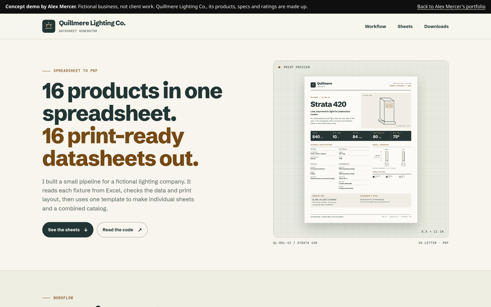

# Quillmere Lighting Co.: spreadsheet to datasheet generator (concept demo)

One spreadsheet of products goes in, and a print-ready one-page PDF datasheet comes out for every row, plus a combined catalog. It's the "we have 1,000 products in Excel and a datasheet template, can you fill it for all of them" job, done as a repeatable script instead of by hand, with checks so a bad cell or a long description gets caught before anything is printed.

**Live demo:** https://alexmercerprojects.com/quillmere-datasheet-generator/

> Concept demo by Alex Mercer. Quillmere Lighting Co. is a made-up lighting company. Every product, spec, rating and listing in the spreadsheet is example data, and the certifications are placeholders on purpose. This is not client work.



## What it does with the example file

| | |
|---|---|
| Products in the spreadsheet | 16, across 6 families |
| One-page datasheets out | 16 (US Letter PDF) |
| Catalog | 18 pages: cover, contents and every sheet |
| Errors / warnings on the shipped data | 0 / 0 |
| Errors caught in the deliberately broken file | 17 errors, 1 warning |

## Key features

- Reads `.xlsx` or `.csv`, one row per product, and the two are kept in sync by `tools/make_workbook.py`
- One HTML/CSS print template with simple `{{field}}` and `{{#each}}` blocks; swap it with `--template` and the same data fills a different design
- Checks every cell before printing: required fields, duplicate SKUs, numbers in range, units (mm, kg, Celsius; "120in" or "3 lbs" gets flagged), lumens / watts matching the efficacy column within 2%, known finishes, image files that exist, and a character limit per field
- Then checks the real print layout: Chrome measures every marked text box after the fonts load and reports anything that spills over, and poppler confirms each sheet is exactly one page
- Self-drawn SVG fixture drawings, and a dimension drawing built from each row's width, height and depth (mm and inches)
- Writes a per-product PDF, the combined catalog, a manifest and a validation report (JSON and a readable Markdown table)
- `--strict` exits non-zero on any error, so it can sit in a build step; warnings never block
- Runs Chrome in parallel; the 16 example sheets and the catalog take about 5 seconds
- Standard library Python plus openpyxl (and Pillow for the demo page thumbnails), 15 tests

## Run it

You need Python 3.11+, `openpyxl`, Google Chrome (or Chromium) and poppler (`pdfinfo`, `pdftoppm`).

```
python3 generate.py data/quillmere-products.xlsx --strict
```

```
16/16 sheets written. Catalog: 18 pages. 0 errors, 0 warnings.
Reports and manifest: output/
```

Try the broken file to see the checks:

```
python3 generate.py tests/fixtures/bad-products.csv --output /tmp/bad-run
```

Other options: `--only QL-BOL-42` builds one sheet, `--template path/to/your.html` uses a different design, `--assets` points at your own images, `--workers` sets how many Chrome processes run at once, `--revision` and `--date` go into the sheet footer.

Tests:

```
python3 -m unittest discover -s tests -v
```

The demo page in `docs/` is rebuilt with `python3 tools/build_docs.py` (it runs the generator, renders the thumbnails and copies the downloads).

## Using your own spreadsheet

Keep the column headers in `data/quillmere-products.csv`, replace the rows, and put each product image in `assets/products/` with its filename in the `image` column. The "Read me" tab in the workbook lists every column and its rule. In short:

- Dimensions in millimetres (`width_mm`, `height_mm`, `depth_mm`), weight in kilograms, operating range in Celsius written like `-25 to 45`
- `finishes` is pipe-separated (`Graphite|Bronze|Sand`) and each name must be one the template knows
- `efficacy` has to be within 2% of lumens divided by watts
- Text fields have limits sized to the template (tagline 70 characters, description 420, notes 105 and so on), and the layout check catches anything that still doesn't fit

## What's where

```
generate.py             command line entry point
datasheets/             reading, validating, rendering, PDF output, catalog, reports
template/               datasheet.html + datasheet.css (the print template)
assets/products/        fixture drawings (SVG)
data/                   the example spreadsheet (.xlsx and .csv)
output/                 the sheets, catalog, manifest and validation report from the last run
tests/                  unit and integration tests, plus a deliberately broken spreadsheet
tools/                  workbook and demo page builders
docs/                   the demo page (GitHub Pages)
```

## Licenses

The code is MIT. Schibsted Grotesk and JetBrains Mono are under the SIL Open Font License (`docs/fonts/LICENSE.txt`). The fixture drawings were drawn for this project.
